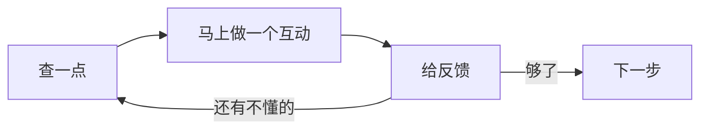

这是 Club 试错过一轮之后得来的结论，记下来免得下次再犯。

## 我们犯过的错

一开始，我们连续安排了好几节「research with AI」：查资料、整理、做笔记、写综述。看起来很扎实。

结果是：

- 学生很快疲了，因为查到的资料不知道要拿来做什么
- 真到「create with AI」的时候，反而选了一个很通用、很泛泛的话题——因为前面攒的资料和后面想做的项目对不上

**研究与创作脱节了。**

## 改法：一课一换

节奏变成：

1. **查一点**——只查下一步要用的那一点，不要一次查完
2. **马上做**——把刚查到的变成一个能点开的东西
3. **给反馈**——找人试，或者自己试
4. **发现不懂的**→ 回到 1

## 为什么这样更好

- 查资料有明确目的，注意力不会散
- 每节课都有可见产出，不容易疲
- 项目的方向是由真实的试错决定的，不是一开始拍脑袋定的

## 一个副作用

这样做的项目，进度看起来"慢"——因为它一直在改。

但到最后，它们通常真的能用。而"一次规划到位"的项目，往往停在漂亮的文档上。
