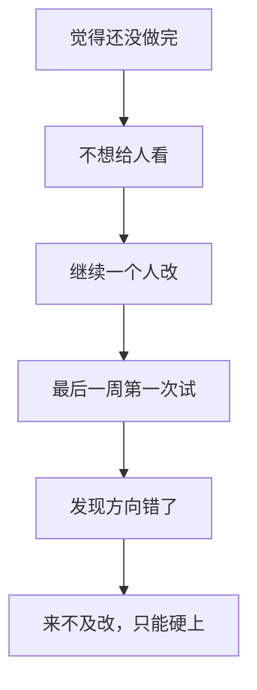

每次展示前一天，总有人在通宵。表面上像"时间不够"，实际上几乎都是同一个原因。

## 崩溃的真实链路

真正的问题在 A：**"还没做完"这个判断，本身就错了。**

一个项目永远不会有"做完了"的时刻。所以"等我做完再给人看"，等于"永远不给人看"。

## 改法

把"给人看"从终点挪到中间：

| 原来 | 改成 |
| --- | --- |
| 做完 → 展示 | 第 1 周就展示一次半成品 |
| 一个人改到最后 | 每两周给一个真人试一次 |
| 展示前一天通宵 | 展示前三天冻结功能，只修 bug |

## 三条截止日前规则

1. **功能冻结线**：展示前 3 天，不再加任何新功能
2. **只修不建**：冻结之后只允许修 bug、改文案、调间距
3. **留一手**：准备一个"最小可演示版本"，万一主版本崩了，用这个

## 关于通宵

通宵做出来的东西，第二天演示时通常自己都讲不清楚。

更糟的是：通宵之后的修改，往往把本来能跑的部分改坏了。**真正的风险不是做得少，是把好的改坏。**

:::caution[给老师的备注]
【待补充：Club 的展示节奏与截止日期安排，以及是否需要提前一周做"冻结检查"】
:::
